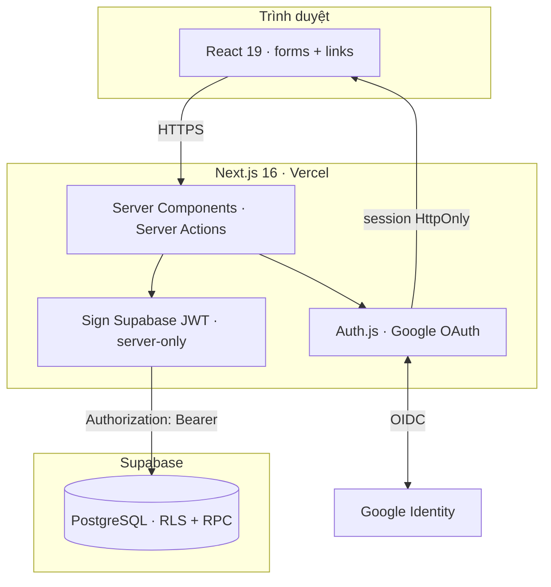
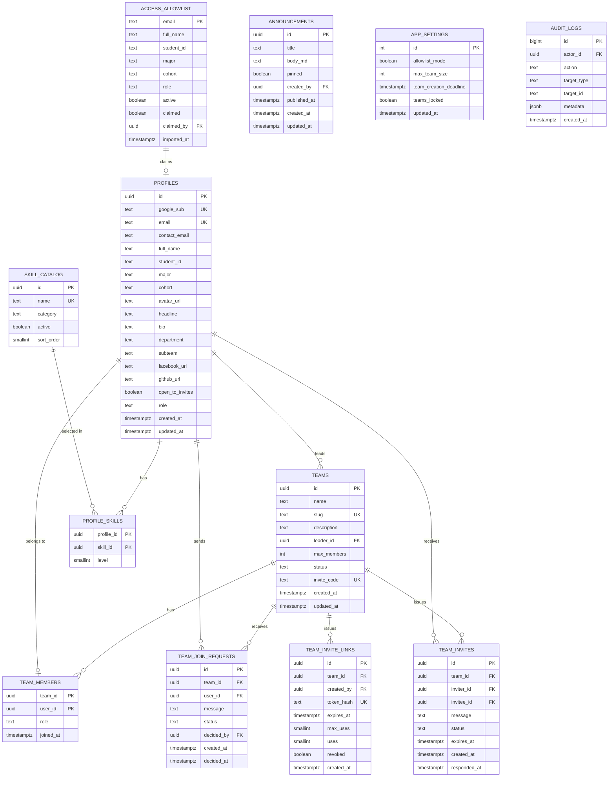
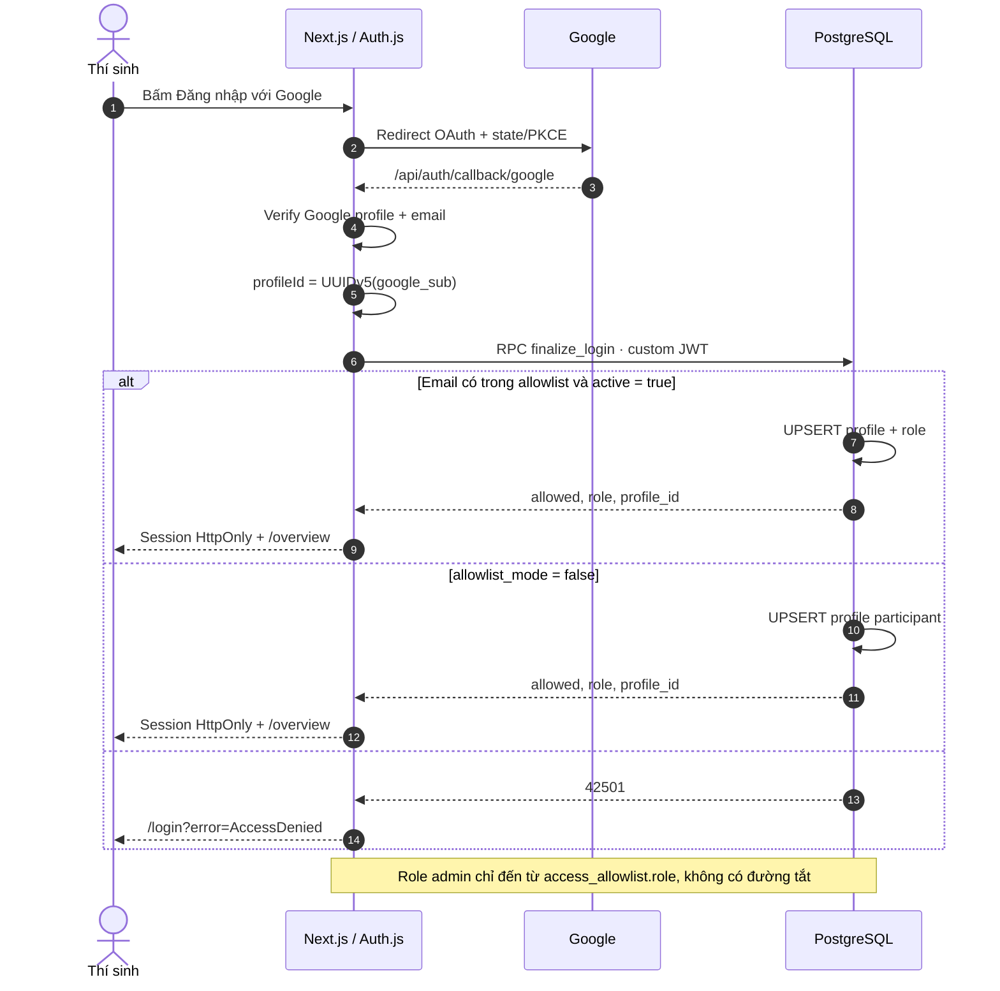
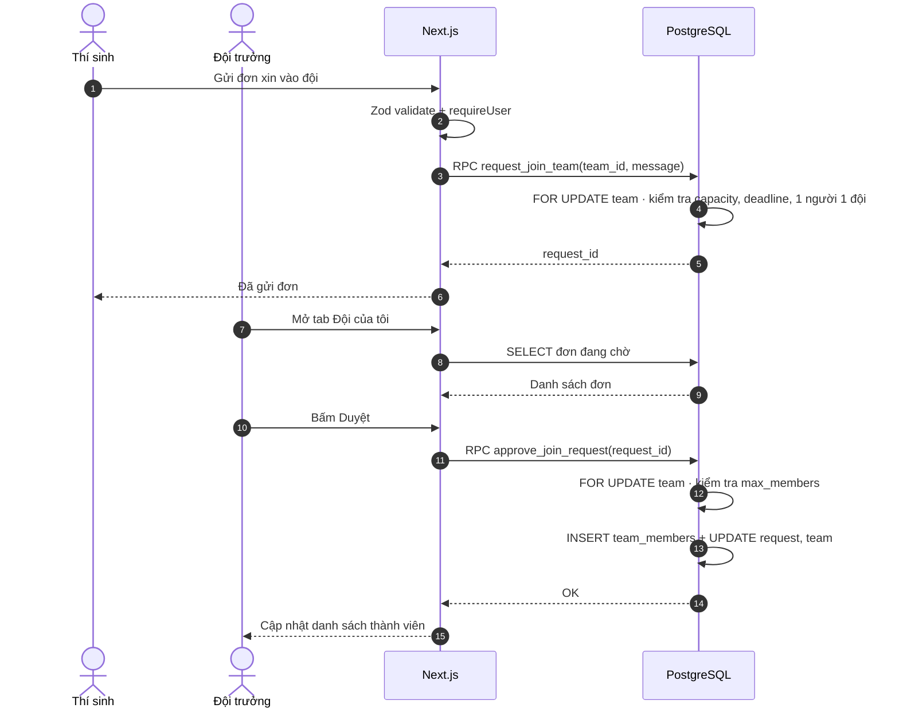
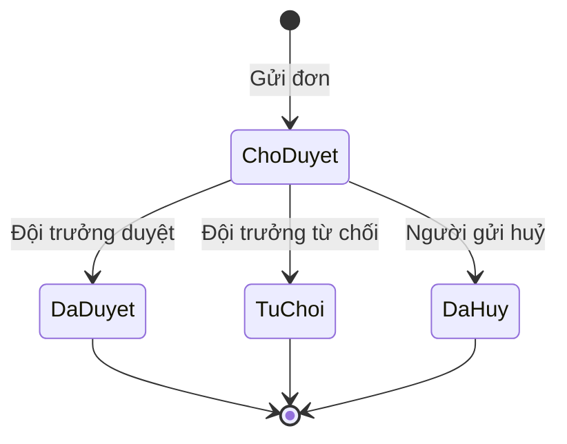

# GDG HUST Internal Hackathon

Nền tảng đăng ký, ghép đội và quản lý thí sinh cho hackathon nội bộ **GDG HUST**.


> **Tài liệu liên quan:** [`design.md`](./design.md) · [`AGENTS.md`](./AGENTS.md) · [`SECURITY.md`](./SECURITY.md) · [`supabase/README.md`](./supabase/README.md)

---

## Mục lục

- [Giới thiệu](#giới-thiệu)
- [Tính năng](#tính-năng)
- [Kiến trúc](#kiến-trúc)
- [Sơ đồ dữ liệu](#sơ-đồ-dữ-liệu)
- [Luồng chính](#luồng-chính)
- [Công nghệ](#công-nghệ)
- [Bắt đầu](#bắt-đầu)
- [Biến môi trường](#biến-môi-trường)
- [Scripts](#scripts)
- [Cấu trúc thư mục](#cấu-trúc-thư-mục)
- [Phân quyền](#phân-quyền)
- [Roadmap](#roadmap)
- [Đóng góp](#đóng-góp)
- [Bảo mật](#bảo-mật)
- [Giấy phép](#giấy-phép)

---

## Giới thiệu

Website phục vụ cuộc thi hackathon nội bộ của GDG HUST, tập trung vào ba việc:

1. **Tạo thí sinh** — BTC nhập danh sách email và thông tin thí sinh trước; thí sinh đăng nhập bằng Google và hoàn thiện hồ sơ.
2. **Tạo đội & ghép đội** — thí sinh tạo đội, mời người khác, hoặc xin vào đội; đội trưởng duyệt đơn.
3. **Landing page & tổng quan** — thông tin sự kiện, thông báo markdown của BTC (chèn link tuỳ ý), deadline và trạng thái đội.

Website không mở đăng ký công khai. BTC kiểm soát danh sách truy cập — **bao gồm cả email của BTC/admin** — và có thể bật/tắt chế độ allowlist cho thí sinh.

---

## Tính năng

### Thí sinh

- Đăng nhập bằng **Google OAuth**.
- Hồ sơ cá nhân đầy đủ:
  - **Định danh:** họ tên, MSSV, ngành học, khóa (vd K70, K71), avatar Google (chỉ đọc).
  - **Liên hệ:** email Google (chỉ đọc), email liên hệ, Facebook, GitHub.
  - **Giới thiệu:** headline, bio.
  - **Kỹ năng:** chọn **tối đa 5 kỹ năng** từ danh mục do BTC định nghĩa, mỗi kỹ năng có mức **1–5**; role mong muốn.
  - **Ghép đội:** bật/tắt **“Đang tìm đội”**.
- **Tạo đội** khi chưa có đội: tên, mô tả, số thành viên tối đa.
- **Quản lý đội**: danh sách thành viên, đơn xin vào, lời mời đã gửi, link mời, rời đội.
- **Tìm đội**: duyệt các đội đang tuyển, lọc theo kỹ năng/vị trí, gửi đơn xin vào.
- **Tìm đồng đội**: duyệt thí sinh đang mở nhận lời mời, gửi lời mời trực tiếp.
- **Tổng quan**: thông báo markdown (có thể chèn link trong từng đoạn), đếm ngược deadline.

**Hồ sơ thí sinh**

| Trường | Kiểu | Ghi chú |
|---|---|---|
| `email` | text, unique | Lấy từ Google, **chỉ đọc** |
| `contact_email` | text | Email liên hệ, có thể khác email Google |
| `major` | text | Ngành học |
| `cohort` | text | Khóa, vd `K70`, `K71` |
| `facebook_url`, `github_url` | text | Tuỳ chọn, URL `https://` hợp lệ |
| `department` | text | `developer`, `marcom`, `operation` |
| `subteam` | text | Dev: Data & AI / Web / Mobile · Marcom: Content / Design / Photo · Operation: Event / Human Resources / Partnership |
| `open_to_invites` | boolean | Bật/tắt nhận lời mời |
| `avatar_url` | text | Lấy từ Google, **chỉ đọc**, không cho đổi |
| `skills` | `profile_skills` | **Tối đa 5** kỹ năng, chọn từ `skill_catalog`, mỗi kỹ năng có mức 1–5 |

**Danh mục kỹ năng (`skill_catalog`)** do BTC quản lý: `name`, `category`, `active`, `sort_order`. Thí sinh chỉ chọn được kỹ năng đang `active`.

Email và các link cá nhân chỉ hiển thị cho người đã đăng nhập; khách vãng lai không đọc được profile. Avatar lấy từ Google, không có upload.

### BTC / Admin

- Nhập danh sách truy cập từ CSV (email + họ tên + MSSV + ngành + khóa + role `participant`/`admin`); **email BTC cũng phải nằm trong danh sách**.
- Bật/tắt **allowlist mode** — khi bật, chỉ email trong danh sách mới đăng nhập được. Admin luôn phải có trong danh sách, kể cả khi tắt allowlist.
- Cấu hình **số thành viên tối đa**, **deadline tạo đội**, **khóa đội** — không hardcode.
- Quản lý **danh mục kỹ năng** (`skill_catalog`) — thêm, sửa, ẩn/hiện.
- Quản lý thí sinh và đội: xem, khóa, chuyển đội trưởng, xóa thành viên.
- Đăng thông báo markdown (chèn link trong từng đoạn) và ghim lên trang Tổng quan.
- Xem thống kê: số thí sinh, số đội, số người chưa có đội.

### Quy tắc nghiệp vụ

- Mọi tài khoản — **kể cả BTC/admin** — phải có email trong `access_allowlist`; không có đường tắt admin.
- Mỗi người chỉ thuộc **một đội**.
- Đội tối đa do BTC cấu hình; mặc định 5.
- Tạo đội và nhận đơn bị chặn sau deadline hoặc khi BTC khóa.
- Không cần BTC duyệt khi tạo đội.
- Thí sinh chỉ thấy dữ liệu hồ sơ công khai cần cho việc ghép đội.

---

## Kiến trúc



**Nguyên tắc:**

- UI không truy cập database trực tiếp cho dữ liệu nhạy cảm; mọi thao tác đi qua Server Components, Server Actions hoặc RPC.
- RLS là lớp bảo vệ cuối cùng; quyền vẫn được kiểm tra ở server.
- Các thao tác đội (tạo, mời, xin vào, duyệt) chạy trong RPC có transaction và row lock để tránh race condition.

---

## Sơ đồ dữ liệu



**Ràng buộc quan trọng**

| Ràng buộc | Mục đích |
|---|---|
| `profiles.id = UUIDv5(google_sub)` | ID hồ sơ ổn định, không phụ thuộc Supabase Auth |
| `profiles.google_sub` unique | Một tài khoản Google ↔ một hồ sơ |
| `profiles.email` unique | Chống trùng thí sinh |
| `team_members.user_id` unique | Mỗi người chỉ thuộc một đội |
| `team_join_requests (team_id, user_id) WHERE status = 'pending'` unique | Chống spam đơn |
| `team_invites (team_id, invitee_id) WHERE status = 'pending'` unique | Chống spam lời mời |
| `teams.status = 'full'` khi đủ người | Đóng tuyển tự động |

---

## Luồng chính

### 1. Đăng nhập và kiểm tra allowlist



### 2. Xin vào đội và đội trưởng duyệt



### 3. Trạng thái đơn xin vào đội



---

## Công nghệ

| Thành phần | Công nghệ | Vai trò |
|---|---|---|
| Framework | Next.js 16 (App Router) | SSR, Server Actions, routing |
| Ngôn ngữ | TypeScript strict | An toàn kiểu dữ liệu |
| UI | React 19 + Tailwind CSS v4 | Giao diện theo `design.md` |
| Auth | Auth.js + Google OAuth | Session `HttpOnly`, không lưu token trong JS |
| JWT | `jose` (HS256) | Custom Supabase JWT để RLS nhận đúng user |
| Database | Supabase PostgreSQL | Dữ liệu, RLS, RPC |
| Validation | Zod | Kiểm tra input ở server |
| Test | Vitest, Testing Library, Playwright | Unit, component, e2e |
| Deploy | Vercel + Supabase | Hosting và hạ tầng |

---

## Bắt đầu

### Yêu cầu

- Node.js **≥ 20**
- npm **≥ 10**
- Tài khoản Supabase và project mới
- Google Cloud project có OAuth Client

### 1. Cài đặt

```bash
git clone <repo-url> internal-hackathon
cd internal-hackathon
npm install
```

### 2. Cấu hình Supabase

1. Tạo project tại [supabase.com](https://supabase.com).
2. Liên kết CLI và đẩy migration:

```bash
npx supabase login
npx supabase link --project-ref <project-ref>
npx supabase db push
```

3. Mở **Authentication → Third-party auth** và thêm JWT secret HS256. Giá trị là `SUPABASE_JWT_SECRET` trong `.env.local` (mở file để copy, không commit).
4. Nếu chạy local: `npx supabase start` và `npx supabase db reset`.

> App **không dùng Supabase Auth**. Supabase chỉ xác thực JWT do Next.js ký và áp RLS.

### 3. Google OAuth

1. Google Cloud Console → OAuth client (Web application) → Authorized redirect URIs:

```text
http://localhost:3000/api/auth/callback/google
https://<production-domain>/api/auth/callback/google
```

2. Điền Client ID/Secret vào `AUTH_GOOGLE_ID` và `AUTH_GOOGLE_SECRET`.

### 4. Biến môi trường

```bash
cp .env.example .env.local
```

Điền các giá trị trong `.env.local` (xem bảng bên dưới).

### 5. Chạy

```bash
npm run dev
```

Mở [http://localhost:3000](http://localhost:3000).

### 6. Tạo admin đầu tiên

Admin/BTC cũng phải nằm trong allowlist. Thêm email BTC **trước** khi họ đăng nhập:

```sql
insert into public.access_allowlist (email, full_name, role)
values ('admin@example.com', 'BTC Admin', 'admin')
on conflict (email) do update set role = 'admin', active = true;
```

Lần đăng nhập đầu tiên, app tạo profile với `role` lấy từ allowlist. Nếu profile đã tồn tại, đồng bộ lại:

```sql
update public.profiles
set role = 'admin'
where email = 'admin@example.com';
```

Không hardcode email admin trong code client. Gỡ admin bằng cách đặt `active = false` hoặc đổi `role = 'participant'` trong `access_allowlist`, sau đó đồng bộ profile.

---

## Biến môi trường

| Biến | Phạm vi | Bắt buộc | Mô tả |
|---|---|---|---|
| `NEXT_PUBLIC_SUPABASE_URL` | Public | ✅ | URL project Supabase |
| `NEXT_PUBLIC_SUPABASE_PUBLISHABLE_KEY` | Public | ✅ | Publishable key |
| `NEXT_PUBLIC_SITE_URL` | Public | ✅ | URL gốc cho link mời |
| `AUTH_URL` | Server | ✅ | URL gốc của Auth.js |
| `AUTH_SECRET` | Server | ✅ | Mã hoá session cookie |
| `AUTH_TRUST_HOST` | Server | ✅ | `true` khi chạy sau proxy/Vercel |
| `AUTH_GOOGLE_ID` | Server | ✅ | Google OAuth client ID |
| `AUTH_GOOGLE_SECRET` | Server | ✅ | Google OAuth client secret |
| `SUPABASE_JWT_SECRET` | Server | ✅ | HS256 secret, khớp Supabase Third-Party Auth |

> ⚠️ Không đặt secret trong biến `NEXT_PUBLIC_*`. App không cần service role key: mọi thao tác admin đi qua RPC kiểm tra `is_admin()`.

---

## Scripts

| Lệnh | Mô tả |
|---|---|
| `npm run dev` | Chạy dev server |
| `npm run build` | Build production |
| `npm start` | Chạy bản build |
| `npm run lint` | ESLint |
| `npm run typecheck` | Kiểm tra TypeScript |
| `npx supabase start` | Supabase local |
| `npx supabase db reset` | Reset DB local + seed |
| `npx supabase db push` | Đẩy migration lên project |

---

## Cấu trúc thư mục

```text
.
├── auth.ts                         # Auth.js config (Google)
├── app/
│   ├── page.tsx                    # Landing page
│   ├── login/page.tsx              # Đăng nhập
│   ├── join/[token]/page.tsx       # Nhận link mời
│   ├── api/auth/[...nextauth]/     # Auth.js handlers
│   ├── (dashboard)/
│   │   ├── layout.tsx              # Layout thí sinh
│   │   ├── overview/page.tsx       # Tổng quan
│   │   ├── team/page.tsx           # Đội của tôi
│   │   ├── teams/page.tsx          # Tìm đội
│   │   ├── participants/page.tsx   # Tìm đồng đội
│   │   └── profile/page.tsx        # Hồ sơ
│   └── admin/
│       ├── layout.tsx              # Layout BTC riêng
│       └── page.tsx                # Quản trị
├── components/
│   ├── ui/                         # Button, input, card, markdown…
│   ├── admin/                      # Settings, import, announcement
│   ├── app-shell.tsx
│   ├── profile-form.tsx
│   └── skill-editor.tsx
├── lib/
│   ├── actions/                    # Server Actions
│   ├── auth/                       # session, JWT, guards
│   ├── supabase/                   # user client
│   ├── validation/                 # Zod schemas
│   └── utils/                      # Pure helpers
├── supabase/
│   ├── migrations/                 # SQL migrations
│   ├── seed.sql                    # Seed local
│   └── README.md                   # Schema + RPC docs
├── types/
│   ├── db.ts
│   └── next-auth.d.ts
├── design.md                       # Design system
├── AGENTS.md                       # Hướng dẫn cho AI coding agents
├── SECURITY.md                     # Chính sách bảo mật
├── .env.example
└── README.md
```

---

## Phân quyền

Mọi role — kể cả BTC — chỉ được truy cập khi email có trong `access_allowlist` và `active = true`.

| Hành động | Thí sinh | Đội trưởng | BTC |
|---|:---:|:---:|:---:|
| Xem landing page | ✅ | ✅ | ✅ |
| Đăng nhập (allowlist) | ✅ | ✅ | ✅ |
| Sửa hồ sơ của mình | ✅ | ✅ | ✅ |
| Tạo đội (trước deadline) | ✅ | — | ✅ |
| Mời thành viên | — | ✅ | ✅ |
| Xin vào đội | ✅ | — | ✅ |
| Duyệt / từ chối đơn | — | ✅ | ✅ |
| Rời đội | ✅ | ✅ | ✅ |
| Chuyển đội trưởng | — | ✅ | ✅ |
| Nhập danh sách truy cập (thí sinh + BTC) | — | — | ✅ |
| Bật/tắt allowlist | — | — | ✅ |
| Quản lý danh mục kỹ năng | — | — | ✅ |
| Cấu hình deadline, max size, khóa đội | — | — | ✅ |
| Đăng thông báo | — | — | ✅ |
| Xem toàn bộ thí sinh/đội | — | — | ✅ |

---

## Roadmap

- [x] Landing page và design system
- [x] Thiết kế schema, RLS, RPC
- [x] Auth.js Google OAuth + allowlist gate cho mọi role (kể cả admin)
- [x] Hồ sơ thí sinh + 5 skill từ danh mục + skill bar
- [x] Tạo đội, mời, xin vào, duyệt đơn
- [x] Tìm đội và tìm đồng đội
- [x] Trang Tổng quan + thông báo markdown
- [x] Admin console + import CSV + settings
- [x] Link mời bằng token
- [ ] Kiểm thử RLS và e2e tự động
- [ ] Nộp ý tưởng/bài thi (nếu BTC cần)

---

## Đóng góp

1. Tạo nhánh từ `main`: `feat/<việc-đang-làm>`.
2. Đọc `AGENTS.md` và `design.md` trước khi code.
3. Chạy đủ kiểm tra:

```bash
npm run lint && npm run typecheck && npm test && npm run build
```

4. Mở pull request, ghi rõ thay đổi, ảnh chụp UI và ghi chú migration.
5. Chờ review từ maintainer.

Quy ước commit và PR chi tiết nằm trong `AGENTS.md`.

---

## Bảo mật

Vui lòng **không** mở issue công khai cho lỗ hổng bảo mật. Đọc
[`SECURITY.md`](./SECURITY.md) để biết kênh báo cáo, phạm vi, thời gian phản hồi
và chính sách safe harbor.

---

## Giấy phép

Dự án nội bộ của GDG HUST. Mọi quyền được bảo lưu.

Nếu BTC quyết định mở mã nguồn, thay mục này bằng giấy phép phù hợp (ví dụ MIT)
và cập nhật thông tin bản quyền.
